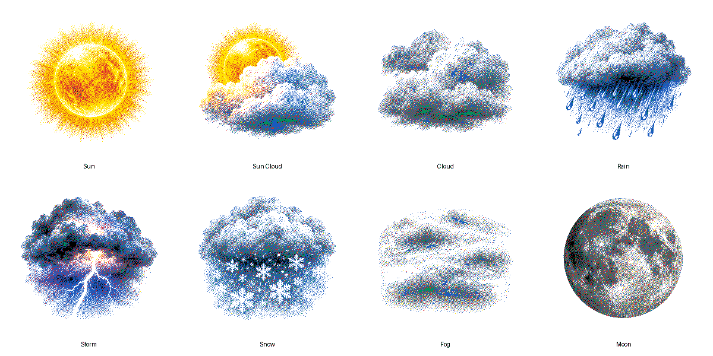

# RC19.2 Photorealistic HD+ artwork pilot

This update bundles eight original weather illustrations in `spectradash/assets/photorealistic/`. The existing renderer automatically uses the artwork for HD+ icons in all layouts that call `_icon`. Standard and HD retain the original vector-style icons. The realistic lunar phase renderer is retained for moon phase widgets; the moon artwork is used for nighttime weather iconography only.

Set **Spectra rendering quality** to **HD+** in Settings to enable the artwork. The new `photo_weather_icons` configuration defaults to true; set false to revert to the older HD+ illustrations without changing quality mode. All art is converted to the physical Spectra six-color palette by the existing final render pipeline; appearance on the panel will differ from the full-color originals.

This is a pilot: verify browser preview first, then send a refresh to the physical panel. Rendering time and quality on Pi Zero 2 W are not yet hardware-verified.

## Artwork gallery

These are software samples, not physical panel photographs.
